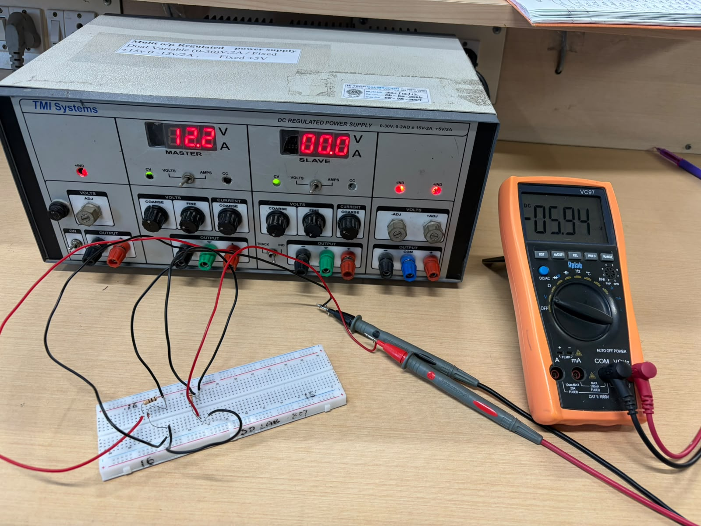
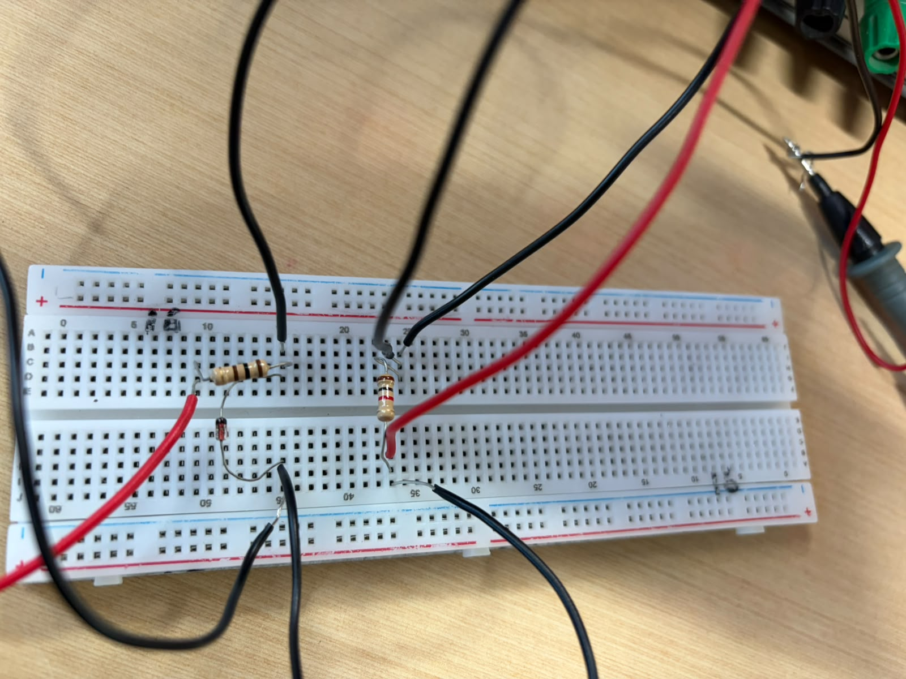

# Zener Diode Shunt Voltage Regulator (6.2V)

Design, analysis, and LTspice verification of a 6.2V Zener diode shunt voltage regulator. The project connects reverse-breakdown semiconductor physics to practical circuit design—covering current limiting, worst-case thermal margins, line/load regulation, and efficiency trade-offs.

---

## Circuit Prototype & LTspice Simulation
<!-- Replace filenames below with the exact names you upload to GitHub -->




---

## Working Principle
* **Reverse Breakdown:** A heavily doped p–n junction forms a very narrow depletion region ($W$), creating an intense electric field ($E \approx V_R / W$) even at low reverse voltages. Below ~5 V, quantum tunnelling (Zener effect) dominates with a negative temperature coefficient; above ~7 V, impact ionisation (avalanche breakdown) dominates with a positive temperature coefficient. Around 6.2 V, both effects balance out for better thermal stability.
* **Shunt Regulation:** Connected in reverse bias parallel to the load ($R_L$), the Zener diode holds the output near $V_Z$ while the series resistor ($R_S$) drops the excess input voltage ($V_{in} - V_Z$) and limits total current ($I_S = I_Z + I_L$).
* **Operating Window:** Regulation holds only while $I_{Z,\min} \le I_Z \le I_{Z,\max}$—below the knee current the diode drops out of breakdown, and above $I_{Z,\max}$ it risks thermal damage.

---

## Circuit Parameters & Simulation Setup
* **Zener Diode (`D1`):** `BZX84C6V2L` (Nominal $V_Z \approx 6.2\text{ V}$, reverse-biased, ~250 mW SOT-23 rating)
* **Series Resistor (`R1` / $R_S$):** $200\ \Omega$
* **Load Resistor (`R2` / $R_L$):** $1\text{ k}\Omega$
* **DC Sweep (`V1`):** `0 V` to `15 V` in `0.1 V` steps (`.dc V1 0 15 0.1`)
* **Plotted Quantities:** Load voltage `V(n002)`, Zener current `I(D1)`, and load current `I(R2)`

---

## Analytical vs. Simulated Results
* **Regulation Onset:** Hand calculation predicts breakdown starts at $V_{in,\text{onset}} = V_Z\left(1 + \frac{R_S}{R_L}\right) \approx 7.44\text{ V}$. LTspice confirms clamping begins between **7 V and 8 V**.
* **Line Regulation (8 V – 15 V):** Output `V(n002)` clamps around **6.2 V – 6.5 V** (~0.2 V drift across a 7 V input swing $\rightarrow$ ~0.03 V/V or ~3% line regulation due to the diode's finite dynamic resistance).
* **Current Shunting:** Load current `I(R2)` settles near **6.2 mA**, while the Zener diode shunts the excess current up to **~36 mA** at 15 V.

| $V_{in}$ (V) | $I_S$ (mA) | $I_L$ (mA) | $I_Z$ (mA) | $P_Z$ (mW) | $P_{RS}$ (mW) |
| :--- | :--- | :--- | :--- | :--- | :--- |
| 10 | 19.0 | 6.2 | 12.8 | 79 | 72 |
| 12 | 29.0 | 6.2 | 22.8 | 141 | 168 |
| 15 | 44.0 | 6.2 | 37.8 | 234 | 387 |

---

## Thermal Margins, Efficiency & Applications
* **Worst-Case No-Load Check:** If $R_L$ is disconnected at $V_{in} = 15\text{ V}$, all 44 mA flows through the diode ($P_D \approx 273\text{ mW}$), exceeding a typical 250 mW SOT-23 rating. Safe no-load operation at 15 V requires $R_S > 218\ \Omega$ and at least a **0.5 W** series resistor ($P_{RS} \approx 387\text{ mW}$).
* **Efficiency:** Shunt regulators continuously dissipate power in $R_S$ and $D_1$. At 15 V, only ~38 mW reaches the load out of ~660 mW drawn from the source.
* **Best Use Cases:** Low-current voltage references, overvoltage rail protection, and GPIO clamping (e.g., protecting 3.3V microcontroller pins from 5V logic). For higher-current loads, a linear regulator such as the **LM7805** is more practical.

---

## LTspice Netlist
```spice
V1 N001 0 12
R1 N001 N002 200
D1 0 N002 BZX84C6V2L
R2 N002 0 1000
.dc V1 0 15 0.1
